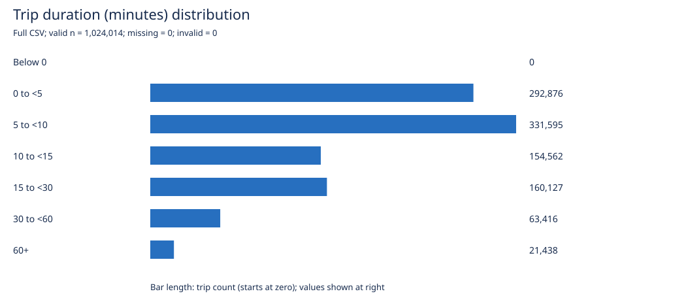
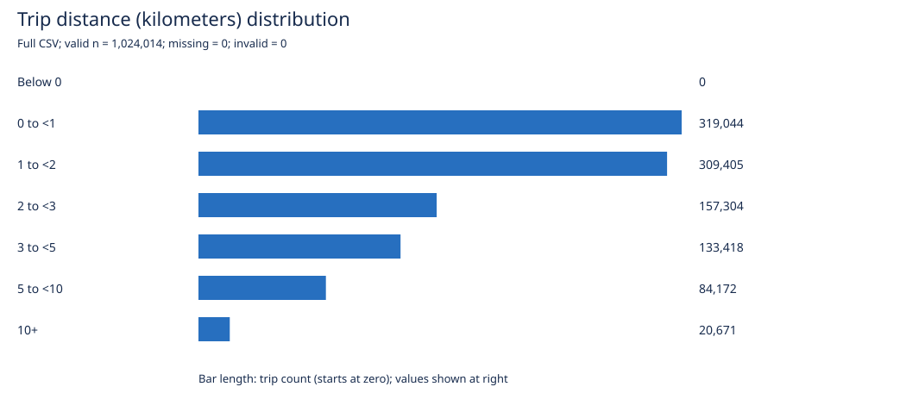
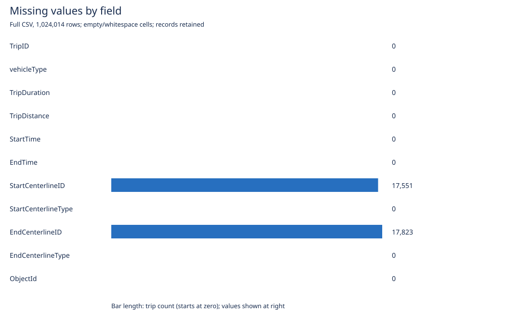
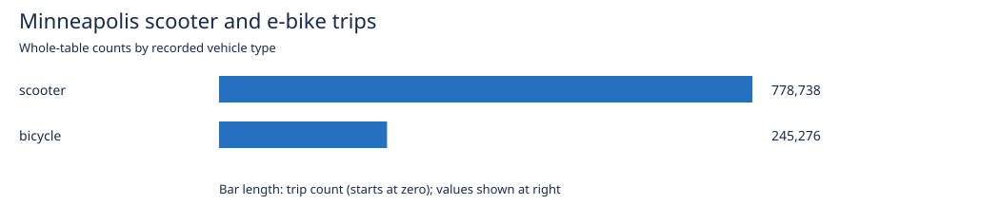

# Initial dataset exploration

Source: [Motorized Scooter and eBike Trips 2025](https://services.arcgis.com/afSMGVsC7QlRK1kZ/arcgis/rest/services/_Motorized_Scooter_and_eBike_Trips_2025/FeatureServer/0)

- Rows (whole table): **1,024,014**
- Columns: **11**
- ArcGIS layer type: **Table** (no geometry).
- StartTime range (service UTC): 2025-04-08T01:30:00+00:00 to 2026-01-01T05:30:00+00:00.
- EndTime range (service UTC): 2025-04-08T01:30:00+00:00 to 2026-01-01T05:30:00+00:00.

## Fields and missing values (whole table)

| Field | ArcGIS storage type | Meaning / analytical role | Null values |
|---|---|---|---:|
| TripID | esriFieldTypeInteger | Trip identifier (not a measurement) | 0 |
| vehicleType | esriFieldTypeString | Category: scooter or bicycle | 0 |
| TripDuration | esriFieldTypeInteger | Numeric measurement, seconds | 0 |
| TripDistance | esriFieldTypeInteger | Numeric measurement, meters | 0 |
| StartTime | esriFieldTypeDate | Datetime, rounded to half hour; service declares UTC | 0 |
| EndTime | esriFieldTypeDate | Datetime, rounded to half hour; service declares UTC | 0 |
| StartCenterlineID | esriFieldTypeDouble | Start segment join key (not a coordinate) | 17,551 |
| StartCenterlineType | esriFieldTypeString | Category: street or trail | 0 |
| EndCenterlineID | esriFieldTypeDouble | End segment join key (not a coordinate) | 17,823 |
| EndCenterlineType | esriFieldTypeString | Category: street or trail | 0 |
| ObjectId | esriFieldTypeOID | ArcGIS row identifier (not a measurement) | 0 |

Counts detect nulls, not blank strings, sentinel IDs, or invalid values.

## Duration and distance (whole table, nulls excluded)

| Variable | Minimum | Mean | Maximum |
|---|---:|---:|---:|
| Duration (minutes) | 0.02 | 12.51 | 190.22 |
| Distance (kilometers) | 0.00 | 2.31 | 33.15 |

## vehicleType (whole table)

| Category | Trips | Share |
|---|---:|---:|
| scooter | 778,738 | 76.05% |
| bicycle | 245,276 | 23.95% |

## StartCenterlineType (whole table)

| Category | Trips | Share | Null location IDs |
|---|---:|---:|---:|
| street | 1,006,463 | 98.29% | 0 |
| trail | 17,551 | 1.71% | 17,551 |

## EndCenterlineType (whole table)

| Category | Trips | Share | Null location IDs |
|---|---:|---:|---:|
| street | 1,006,191 | 98.26% | 0 |
| trail | 17,823 | 1.74% | 17,823 |

## Full local CSV: distributions and quality

Analyzed all **1,024,014** local CSV rows; row count agrees with the cached API count.
Missing means an empty or whitespace-only CSV cell. Numeric parse errors and nonfinite values are reported separately; valid zeros and negative values are retained.

| Measurement | Valid n | Median | 25th percentile | 75th percentile | 95th percentile | Zero | Negative | Invalid |
|---|---:|---:|---:|---:|---:|---:|---:|---:|
| Duration (minutes) | 1,024,014 | 7.87 | 4.58 | 14.48 | 39.70 | 0 | 0 | 0 |
| Distance (kilometers) | 1,024,014 | 1.56 | 0.84 | 2.84 | 7.07 | 0 | 0 | 0 |

Quantiles use linear interpolation at rank (n − 1) × p. Means and medians describe different aspects of the distribution; inspect the upper tail before choosing a summary.

| Field | Missing CSV cells | Percent of all rows |
|---|---:|---:|
| TripID | 0 | 0.00% |
| vehicleType | 0 | 0.00% |
| TripDuration | 0 | 0.00% |
| TripDistance | 0 | 0.00% |
| StartTime | 0 | 0.00% |
| EndTime | 0 | 0.00% |
| StartCenterlineID | 17,551 | 1.71% |
| StartCenterlineType | 0 | 0.00% |
| EndCenterlineID | 17,823 | 1.74% |
| EndCenterlineType | 0 | 0.00% |
| ObjectId | 0 | 0.00% |

Interpretation and limits are kept in the [activity notes](../../Codex_Activity.md#interpretation-and-limits).

