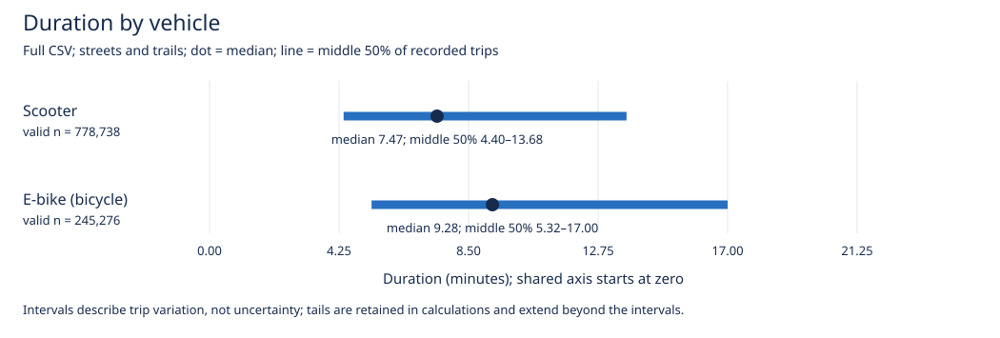
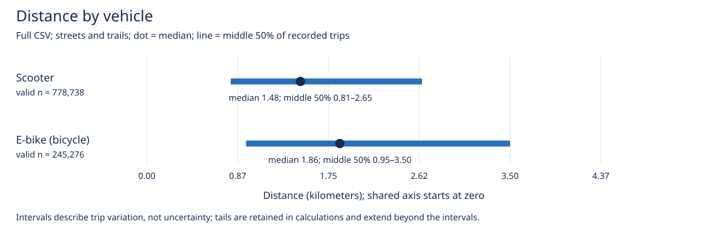

# Duration and distance by vehicle

This follow-up was reviewed in Plan mode before implementation. It supplements the spatial analysis.

The full CSV has **1,024,014** unique, nonmissing TripIDs. Both street and trail trips are included, including records excluded from mapping. No 100-start threshold or street join is applied.

The source categories are `scooter` and `bicycle`; the city describes bicycles as e-bikes. Each measurement independently excludes missing, nonnumeric, nonfinite, zero, and negative values. All valid positive measurements are retained, including unusually long trips. Duration uses the recorded seconds, not differences between rounded timestamps.

Unexpected vehicle categories (excluded): `{}`.

| Vehicle | Measurement | Total trips | Valid n | 25th percentile | Median | 75th percentile |
|---|---|---:|---:|---:|---:|---:|
| scooter | minutes | 778,738 | 778,738 | 4.40 | 7.47 | 13.68 |
| scooter | kilometers | 778,738 | 778,738 | 0.81 | 1.48 | 2.65 |
| bicycle | minutes | 245,276 | 245,276 | 5.32 | 9.28 | 17.00 |
| bicycle | kilometers | 245,276 | 245,276 | 0.95 | 1.86 | 3.50 |

Duration: the e-bike median minus the scooter median is **1.82 minutes**. This is a difference between group medians, not paired trips.
Distance: the e-bike median minus the scooter median is **0.38 kilometers**. This is a difference between group medians, not paired trips.

## Measurement exclusions

| Vehicle | Measurement | Missing | Nonnumeric | Nonfinite | Zero | Negative |
|---|---|---:|---:|---:|---:|---:|
| scooter | TripDuration | 0 | 0 | 0 | 0 | 0 |
| scooter | TripDistance | 0 | 0 | 0 | 0 | 0 |
| bicycle | TripDuration | 0 | 0 | 0 | 0 | 0 |
| bicycle | TripDistance | 0 | 0 | 0 | 0 | 0 |

Quantiles use linear interpolation at rank (n − 1) × p. Chart intervals show the middle 50%, not confidence intervals or the full range. Values describe recorded trips; rider preferences, trip purposes, and causes of differences were not tested.

Exact values and all exclusion counts: [vehicle_comparison.csv](vehicle_comparison.csv). Independent recalculation and source-record conversions: [vehicle_comparison_verification.md](vehicle_comparison_verification.md).

Source CSV SHA-256: `3fce17519012751cc922ed31a7d17508739727fa049e7b888e6b614918524482`.
