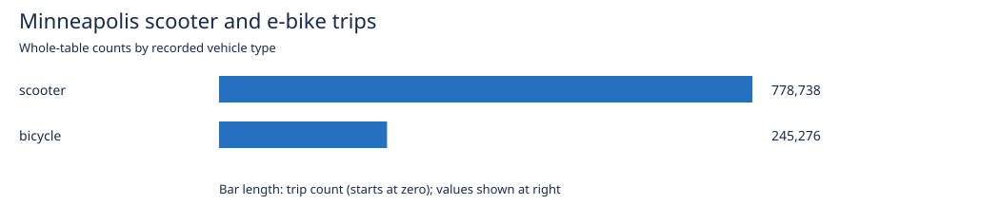
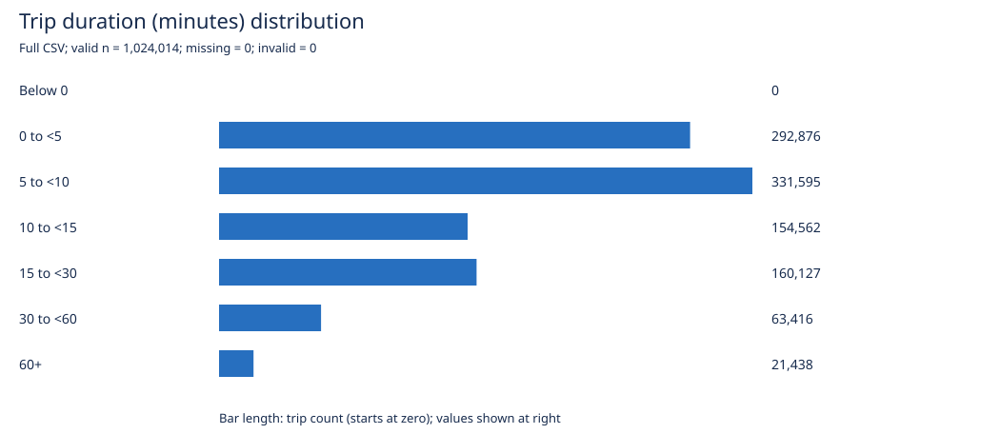
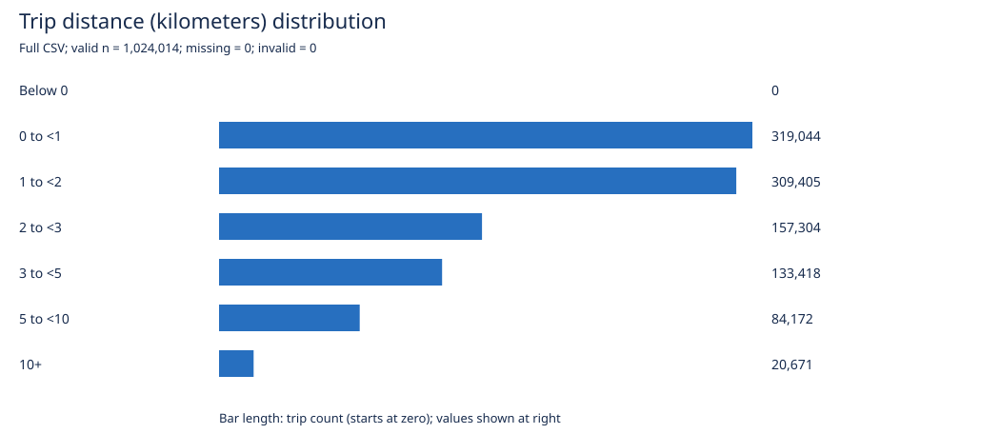
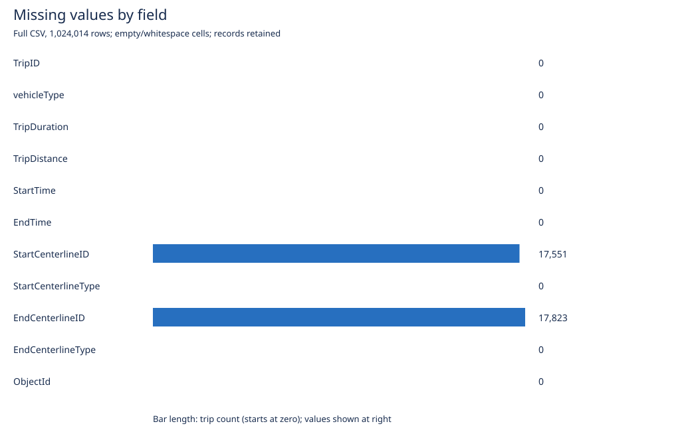

**Name(s): Sohail Mohammed Khan and Dooley Kim**

We used Codex to explore Minneapolis scooter and e-bike trips. The reflections below are drafts for us to review. We still need to review the verification evidence ourselves and complete the assignment's separate Plan-mode review.

# Macalester DS 456 - Projects in Data Science - Codex Activity

*Originally created by Shilad Sen (with help from Codex), 2025/11/25. Updated by Bret Jackson 2026/11/08*

In this activity you will:

- Use Codex as a collaborator on a real spatial dataset.
- Practice being *critical* of Codex’s suggestions (not just accepting them).
- Progress from exploration to a reviewed analysis plan, implement it with Codex, and verify one important result.

# 0. Get the project

- Fork the [Codex Activity](https://github.com/bretjackson/ds-456-codex-activity) on GitHub.
- Clone **your fork** (not the original) to your computer.

# 1. Choose your tools and set up Codex

You may work in **Python (VS Code)** or **R (VS Code or RStudio)**.

## 1.1 Highly Recommended: VS Code + Codex (Python or R)

- Install [VS Code](https://code.visualstudio.com/).
- Install the [Codex VS Code extension](https://developers.openai.com/codex/ide/).
- If you are using R, also install the [VS Code R extension](https://marketplace.visualstudio.com/items?itemName=reditorsupport.r).
- Open your cloned repo folder in VS Code.
- In the Codex sidebar:
  - Click “Use API Key” and use the key Shilad gave you.\
    **DO NOT PUT THIS KEY ANYWHERE IN YOUR GITHUB REPO.**
  - Open Codex settings → “Open `config.toml`” and set it to:
    ```toml
    model = "gpt-6.1-sol"
    model_reasoning_effort = "medium"
    web_search = "live"

    [sandbox_workspace_write]
    network_access = true
    ```
  - Restart VS Code after editing `config.toml`.

## 1.2 Optional: RStudio + Codex in a separate terminal

If you strongly prefer RStudio:

- Use **RStudio** for your R scripts / Rmd files.
- Using a terminal, install the Codex CLI: `npm i -g @openai/codex`
- In a terminal, run `codex` once so it creates a config file at `~/.codex/config.toml`.
- Open `~/.codex/config.toml` in any text editor you like (VS Code, TextEdit, Notepad, `nano`, etc.) and paste the same settings shown in 1.1.
- In a separate terminal window (**from the repo root**), run Codex and use it to:
  - Draft and refactor R code.
  - Ask questions about errors.
- You are still responsible for keeping all code and writeups in this repo so they can be graded.

# 2. Create your assignment skeleton

You will **not** edit this `README.md` directly. Instead:

- Copy `README.md` to `Codex_Activity.md`.
- Add your name(s) at the top of `Codex_Activity.md`.
- For every prompt marked **Task:** below, you will write your answers in `Codex_Activity.md`.
- Your actual analysis code should live in code files, for example:
  - R: `analysis/codex_activity.qmd` or `analysis/codex_activity.R`
  - Python: `analysis/codex_activity.ipynb` or `analysis/codex_activity.py`

You may reference your code files from `Codex_Activity.md` (e.g., “see Figure 1 in `analysis/codex_activity.Rmd`”).

Keep using the same Codex conversation as you move from exploration to mapping and analysis, including when you return for the second class session. If you start a new conversation, provide your research question (if chosen), relevant file paths, and a short summary of what you have discovered.

# 3. Early dataset interactions

- Pick a spatial dataset from [Open Data Minneapolis](https://opendata.minneapolismn.gov).\
  One fun option (used in the instructor example) is\
  [Motorized Foot & eBike Trips in 2025](https://opendata.minneapolismn.gov/datasets/d9a1f322528447ff9c1bc86e5d0895c5_0/explore).
- Give Codex the URL for the dataset and ask it to help you get started understanding the data.\
  Keep your request intentionally vague (e.g., “Help me explore this dataset”).

**Task 3.1 (in `Codex_Activity.md`):**\
In 2–3 short bullets, describe what you notice about this early interaction. Consider:

- What did Codex assume or gloss over?
- Did it make any mistakes or questionable choices?
- How clear or explainable was the code it produced?

Retain useful code and observations from this interaction so you can build on them in the next sections.

### Task 3.1 response

- We started with a vague request, and Codex went straight to a Python script and the city's API. It didn't ask what we wanted to focus on, but it did check the units and notice that the title said 2025 while the description mentioned 2024.
- The first 1,000 rows helped show what a record looked like. Codex explained that these were the first rows in order, so they weren't a random sample of the year.
- The script had comments, but it was a lot of code for a first look at the data. There was also confusion about the writeup: Codex changed the saved file while our editor was still showing the assignment template.

# 4. More directed exploration

- If you are partner coding, *switch partners*.
- Download the dataset you would like to analyze and move it under `data/`.
- Ask Codex to help you analyze the **basic information** about the dataset:
  - basic summaries (rows, columns, variable types),
  - simple visualizations,
  - any surprising patterns.
- Then ask Codex for specific improvements (e.g., “Use `dplyr` instead of base R”, “Add labels and titles”, “Handle missing values more carefully”).
- Save useful exploration code in your analysis file and keep notes about relevant variables and assumptions. You will reuse this work for mapping and your research question.

**Task 4.1 (in `Codex_Activity.md`):**
Respond in 2–3 short bullets, considering:

- What did Codex do well?
- What would you have done differently if you wrote the code yourself?
- Looking at the code Codex wrote, what could be improved (style, clarity, correctness, efficiency)?

### Task 4.1 response

- Codex summarized the 1,024,014 trips and 11 columns and made charts with labels and units. The medians were useful: the average trip lasted 12.51 minutes, but the median was only 7.87 minutes. Distance showed the same pattern.
- If we started again, we'd use the downloaded CSV and a shorter pandas script. The API requests and code for drawing SVGs made this more complicated than it needed to be.
- The missing locations needed more attention than a simple row count. All 17,551 trail starts and 17,823 trail ends were missing segment IDs. Those trips still have useful duration and distance data, so dropping them entirely would lose information.

Supporting work: [exploration report](Analysis/outputs/exploration.md) and [code](Analysis/Codex_activity.py). The report lists the variable types, units, and missing values for each column.

Across the full dataset, there are 778,738 scooter trips (76.05%) and 245,276 bicycle trips (23.95%). The source describes the bicycle category as e-bikes.

| Measurement | Mean | Median | 25th–75th percentiles | 95th percentile |
|---|---:|---:|---:|---:|
| Duration (minutes) | 12.51 | 7.87 | 4.58–14.48 | 39.70 |
| Distance (kilometers) | 2.31 | 1.56 | 0.84–2.84 | 7.07 |









# 5. Mapping the data

- If you are partner coding, *switch partners*.
- Discuss with your partner how you could geocode / map the data.
- Once you have an idea for how to do it, ask Codex to help you map your data. Pay attention to what happens at first:
  - Does it correctly identify what is needed to make a map?
  - Does it confuse attributes (like IDs) with coordinates?

- For the scooter/e‑bike example, the goal is to join trips to a street or trail network such as the\
  [PW Street Centerline dataset](https://opendata.minneapolismn.gov/datasets/pw-street-centerline/about) and then map trip counts by segment.
- Identify a calculation, join, coordinate interpretation, or mapped value you could verify later. In Section 7.3, you will be asked to do some verification.

**Task 5.1 (in `Codex_Activity.md`):**
Respond in 2–3 short bullets, considering:

- Describe what was easier and harder about doing this with Codex.
- Where did Codex help, and where did it get in the way?
- What would you do differently next time you had to map a new dataset with AI assistance?

### Task 5.1 response

- Codex found the city's street network and recognized that the centerline IDs were keys to join on, not coordinates. That gave us a way to map starts without geocoding addresses.
- Getting a map was easier than checking the join. There were 251 repeated GBSIDs in the street network, and some trip start IDs didn't match anything. We left those cases out of the map and kept track of how many trips they represented.
- Next time, we'd check for repeated IDs and unmatched records before making the map. Here, 895,767 starts, or 87.48% of all trips, matched one street feature. That coverage matters when interpreting what the map shows.

The map leaves out 17,551 nonstreet starts, 95,001 starts whose street IDs didn't match, and 15,695 starts whose IDs matched more than one feature. Along with the 895,767 mapped starts, these add up to all 1,024,014 trips. The count map shows every matched segment with a start. The share map below uses our minimum of 100 starts.


This shows **where trips start**, not the routes riders took. The code is in [spatial_analysis.py](Analysis/spatial_analysis.py), with [join counts](Analysis/outputs/spatial_audit.json) and a [list of excluded street IDs](Analysis/outputs/unmatched_start_ids.csv).

# 6. Identifying a research question with Codex

- If you are partner coding, *switch partners*.
- You will now work with Codex to identify and refine a research question (RQ) about your dataset.
- Choose a question you can answer with the downloaded data and a small extension of your existing exploration or mapping code. A descriptive question is sufficient; aim for an analysis you can implement in about 20 minutes.

## 6.1 Brainstorm candidate questions

- Seed the brainstorming session with some themes or ideas of research questions that interest you.
- Ask Codex to propose several possible research questions.
- Collaborate with Codex to prioritize the questions along the decision dimensions you think are most appropriate.

**Task 6.1 (in `Codex_Activity.md`):**

- List at least two candidate research questions that Codex suggested.
- For each, briefly note what seems interesting and what might be problematic (data, scope, ethics, feasibility).

### Task 6.1 response

| Question | Why consider it? | What could be difficult? |
|---|---|---|
| How do trip duration and distance differ between scooters and e-bikes? | The fields are already there, so this would be a straightforward comparison. | A few long trips can pull up the averages. We'd need medians and the recorded duration, since timestamps are rounded. |
| How do scooter and e-bike proportions vary across street segments where trips start? | We could build on our map and see differences that a citywide percentage would hide. | Some locations don't join to the street network. Segments with very few starts could also have misleading percentages. |

We chose the second question. It uses the trip data and street network we were already working with. It can show differences between places, but it can't tell us why those differences exist.

## 6.2 Refine and choose your question

- Pick one question (it may be a slight modification of a Codex suggestion).
- Ask Codex to critique and refine that question. For example:
  - “Here is my tentative research question: […]. Critique its clarity and feasibility. Propose 1–2 improved versions.”
- Decide on a **final RQ** you will try to answer. This choice is yours, not Codex’s.

**Task 6.2 (in `Codex_Activity.md`):**

- Write down your final research question in one clear sentence.
- In 2–3 sentences, explain why you chose it (and why you rejected other candidates).

### Task 6.2 response

**Final RQ:** How do scooter and e-bike shares of trip starts vary across Minneapolis street segments in the 2025 release, counting only segments that match one street feature and have at least 100 starts?

We chose this because it builds on the map and can be answered with the fields we already have. Comparing duration and distance would work too, but we wanted to look at how the vehicle mix changes from place to place. Limiting the question to matched segments with at least 100 starts makes the comparison more useful, though it leaves out some trips.

# 7. Answering your question: plan, implement, and verify

Build on your exploration and map to answer **one research question**. Review a plan with Codex, implement it, and verify one important result or transformation.

## 7.1 Design and review a plan

**Plan mode** lets Codex inspect context, ask clarifying questions, and propose an approach before implementation. It can investigate existing files; it should not implement your analysis while planning. See the [OpenAI guidance on Plan mode](https://learn.chatgpt.com/docs/learn/best-practices).

1. Wait until Codex finishes its current response.
2. In the **Codex chat input inside VS Code**, enter `/plan`, select the command, and press Enter. Check that Plan mode is active. If using Codex CLI alongside RStudio, enter the command in the Codex conversation in your terminal.
3. Submit your planning request and answer any clarifying questions.
4. Review and revise the proposed plan before leaving Plan mode.

Review the plan yourself:

- Does it answer your chosen question using available data?
- Are the units, filters, grouping, and treatment of missing values appropriate?
- Does it reuse relevant exploration or mapping work?
- Is the proposed verification feasible and capable of detecting a meaningful error?

Ask Codex to clarify or revise anything you cannot justify. If you do not understand the type of analysis or choices it is suggesting, stop! Discuss them with your partner and clarify with Codex.

**Task 7.1 (in `Codex_Activity.md`):**

- Record your final plan in 3–5 bullets.
- Explain one decision you made while reviewing it. A justified decision to retain a proposed approach counts; you do not need to change the plan just to make a change. However, don't just blindly accept what it suggests. Stop and discuss each decision with your partner!

### Task 7.1 response

- Use the full CSV and check that each TripID appears once. For the map, keep street starts with a usable start ID and a scooter or bicycle label.
- Count starts by vehicle and start ID, then join to the street network's GBSID. Keep only IDs that match one feature, and count all excluded trips.
- Calculate scooter share as scooter starts divided by all scooter and bicycle starts on that segment. Bicycle share is the remaining percentage. Compare segments with **at least 100 starts**.
- Map the counts and shares. Summarize the range of shares and how many segments have more scooter starts or more bicycle starts.
- Check three segments against separate queries to the city's trip and street services, including the counts, percentages, and street names.

**Decision:** We picked a minimum of 100 starts instead of 50. That leaves 1,775 segments, compared with 2,641 at a minimum of 50. It gives up some coverage so that a handful of trips won't determine a segment's percentage. It doesn't make every percentage equally reliable.

**Still to do:** We chose the question and minimum count in the chat, but haven't completed the assignment's separate Plan-mode review.

## 7.2 Implement and inspect

Use the `/plan` toggle to leave Plan mode and confirm it is off **before** requesting implementation, or Press the "Implement this plan" option if it appears.

- You can request the whole small plan or start with a meaningful first step and continue after inspecting it.
- Keep the work in the R or Python analysis file.
- Inspect the changed code and outputs. Does the analysis answer your question? Are the results interpretable and relevant?
- Ask targeted follow-up questions and revise as needed.

**Task 7.2 (in `Codex_Activity.md`):**

- Briefly state your result and link to the supporting figure, table, or code.
- Describe one implementation choice or issue you examined and what you decided about it.

### Task 7.2 response

The comparison includes **1,775 segments** and **760,736 starts**. Scooter shares range from **7.91% to 98.61%**. Scooters have more starts on **1,686 segments (94.99%)**, e-bikes have more on **86**, and **3** are tied. Across all these starts, **77.27%** are scooters. The median segment's scooter share is **76.89%**; unlike the overall percentage, this gives each segment equal weight.

Scooters account for most starts in most places, but there are clear exceptions. On 3RD AVE S between 46TH ST E and 45TH ST E (GBSID 14327), there are 11 scooter starts and 128 bicycle starts. On CLEVELAND ST NE between BROADWAY ST NE and DEAD END (N) (GBSID 16922), there are 142 scooter starts and only 2 bicycle starts. The data shows that contrast, but doesn't explain it.


Supporting [result report](Analysis/outputs/spatial_analysis.md), [complete segment table](Analysis/outputs/segment_vehicle_shares.csv), and [implementation](Analysis/spatial_analysis.py).

**One issue in the code:** The first attempt stopped at GBSID 11022 because it appeared twice in the network, on two pieces of 21ST AVE S. The revised code leaves out all 251 repeated GBSIDs. That removes 15,695 starts from the map, but avoids counting them twice or guessing which feature to use.

## 7.3 Verify one important result and reflect

Perform **one documented check** of a consequential claim, calculation, or transformation from your exploration, mapping, or final analysis.

Choose a check suited to your dataset. Here are some possibilities you could consider:

| Check | Evidence you could provide |
|---|---|
| Recalculate a summary | Manually compute a count, mean, or percentage for a small identified subset and compare it with the code's result for that subset. |
| Check a join used in mapping | Inspect several known matches against the source records and account for unmatched or duplicated records. |
| Check mapped locations | Compare several identifiable features with an authoritative reference and record specific matches or discrepancies. |
| Check a derived variable | Use documented units and a few source records to calculate expected values independently and compare them with the derived values. |

Successful execution, a plausible-looking map, or Codex saying “this is correct” does not satisfy this requirement. Codex may help write checking code, but **you must explain the basis of the check and inspect its evidence**. Establish an expected result or reference independently of the output you are checking.

**Task 7.3 (in `Codex_Activity.md`):**

Record:

- **What I checked and why it matters.**
- **How I checked it**, including the independently established expectation or reference.
- **What I observed**, with actual values, identified records, or another concrete comparison.
- **What I changed or concluded**, including the result of rechecking any correction.


### Task 7.3 response

**What the check covers:** Counts, scooter percentages, and street names for GBSIDs 16907, 17120, and 19543. An incorrect join or percentage calculation would affect the map and our answer.

**How it works:** These IDs came from the first data preview, rather than being picked because of their final percentages. The checking script asks the city's trip service for counts by start ID and vehicle type. It also asks the street service for the street and cross-street names. Those results give a separate reference to compare with our local output. The requests and responses are saved in [verification_reference.json](Analysis/outputs/verification_reference.json).

**Observed comparisons:**

| GBSID | Expected street | API scooter count | API bicycle count | Expected scooter share | Analysis share | Result |
|---:|---|---:|---:|---|---:|---|
| 16907 | 6TH AVE N: 3RD ST N to WASHINGTON AVE N | 1,480 | 260 | 1480 / (1480 + 260) = 85.0575% | 85.0575% | Counts, share, and street names match |
| 17120 | 1ST AVE N: 3RD ST N to 4TH ST N | 654 | 109 | 654 / (654 + 109) = 85.7143% | 85.7143% | Counts, share, and street names match |
| 19543 | 8TH ST N: 1ST AVE N to HENNEPIN AVE | 417 | 76 | 417 / (417 + 76) = 84.5842% | 84.5842% | Counts, share, and street names match |

**Result:** All three counts, percentages, and street-name matches agree with the city services. No further correction was needed after fixing the repeated-key issue. This checks three specific cases, so it doesn't establish that every segment or original trip record is accurate. See the [verification report](Analysis/outputs/verification.md) and [checking script](Analysis/verify_spatial.py).

**Still to do:** We need to inspect these source counts and calculations ourselves and add our own conclusion. So far, this records the check Codex ran.

# 8. What to hand in

By the end of the activity, your repo should include at least:

- `Codex_Activity.md` with answers to all **Task** prompts (3.1, 4.1, 5.1, 6.1, 6.2, 7.1, 7.2, 7.3), including your reviewed plan, research-question result, and verification evidence.
- At least one analysis file:
  - R: `analysis/codex_activity.qmd` or `analysis/codex_activity.R`
  - Python: `analysis/codex_activity.ipynb` or `analysis/codex_activity.py`
- At least one map saved in the repo and linked from your writeup, or embedded in your analysis/writeup.
- Any additional scripts or notebooks you used, committed in a reasonable state.

Before you’re done:

- Use Codex to help you **commit and push** your work to your forked repo.
- Make sure that your API key is **not** anywhere in the repo.
- Share the URL for the repo (including the markdown and script) on the Moodle activity.

# Interpretation and limits

- The full CSV has 1,024,014 trips and 11 columns, with no repeated TripIDs. The ID fields are keys, not coordinates or measurements.
- Duration is recorded in seconds and distance in meters; our tables use minutes and kilometers. Neither field had missing, invalid, zero, or negative values in this export. We report medians because long trips pull up the means.
- Start and end times are rounded to half hours, so duration should come from `TripDuration`. The service labels times as UTC. Local hours would need checking and conversion to `America/Chicago`.
- The title says 2025, but the description mentions 2024. The actual UTC start times run from April 8, 2025 through January 1, 2026. The city filtered the data before publishing it, though the description of those filters is unclear.
- Trail IDs are missing, and some street IDs are unmatched or repeated. The map uses the current street network, which may differ from the 2025 network. An unmatched ID doesn't necessarily mean a trip happened outside Minneapolis. These exclusions could change the vehicle mix we see.
- The maps show start segments, not routes or individual riders. Shares could reflect differences in vehicle availability, pricing, season, or program coverage. We haven't tested those explanations or made claims about rider preferences.
- All comparisons use the full CSV. The ordered 1,000-row preview isn't a random sample. The overall scooter percentage counts every trip equally; the median segment percentage counts every eligible segment equally.

# Reproducing the work

See [data/README.md](data/README.md) for the source, expected filename, download steps, and input hashes. With existing cached inputs, run from the project root:

```sh
python3 Analysis/Codex_activity.py
python3 Analysis/spatial_analysis.py
python3 Analysis/verify_spatial.py
```

The scripts use Python's standard library and don't need an API key. The large raw downloads are left out of Git, but the reports, maps, tables, and saved verification responses are included.

The work is saved in [our GitHub fork](https://github.com/my-name-arch/ds-456-codex-activity). Before submitting its URL on Moodle, we still need to review the reflections, inspect the verification evidence, and complete the Plan-mode review.
