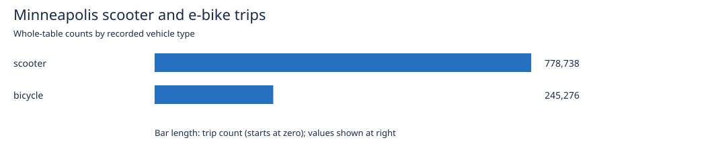
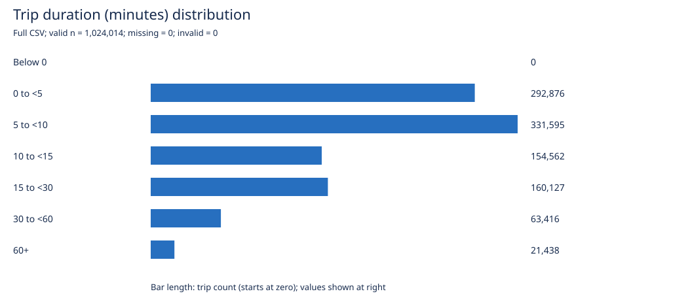
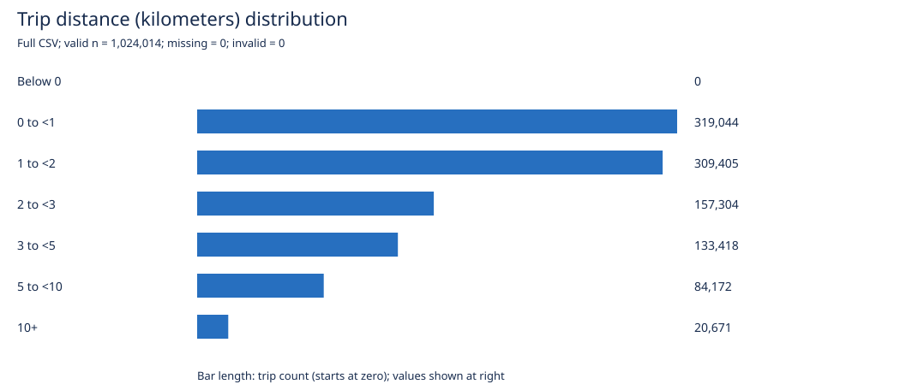
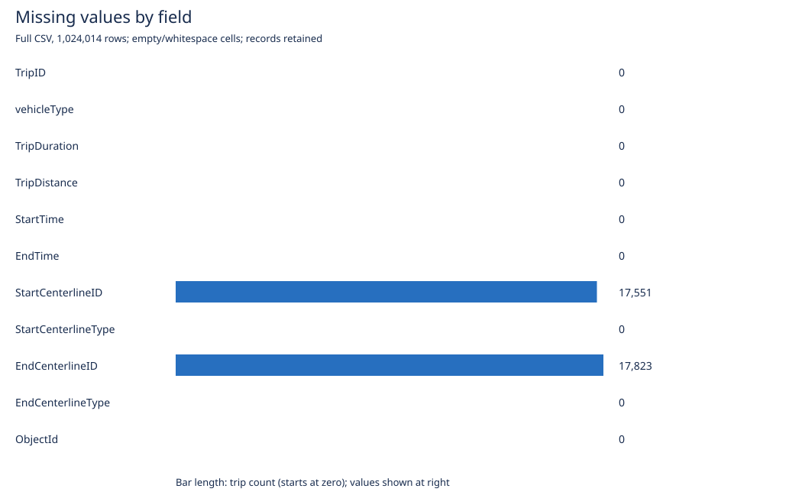

# Dataset exploration notes

Dataset: [Minneapolis Motorized Scooter and eBike Trips 2025](https://opendata.minneapolismn.gov/datasets/d9a1f322528447ff9c1bc86e5d0895c5_0/explore)

Code: [Analysis/Codex_activity.py](Analysis/Codex_activity.py). Detailed tables and figures: [exploration report](Analysis/outputs/exploration.md).

These notes support the activity. The Task 4.1 reflection below is a draft to review and adapt; the final research question remains to be chosen.

## Basic information

- The full downloaded CSV contains **1,024,014 rows and 11 columns**, matching the cached API row count. Each row represents a trip; uniqueness of TripID has not yet been checked.
- Numeric measurements: `TripDuration` (seconds) and `TripDistance` (meters). `vehicleType` and the two centerline-type fields are categories. `StartTime` and `EndTime` are datetimes. `TripID`, `ObjectId`, and centerline IDs are identifiers, even though the service stores them as numbers.
- Vehicle mix: **778,738 scooters (76.05%)** and **245,276 bicycles (23.95%)**. The source describes the bicycle category as e-bikes.

| Measurement | Mean | Median | 25th–75th percentiles | 95th percentile |
|---|---:|---:|---:|---:|
| Duration (minutes) | 12.51 | 7.87 | 4.58–14.48 | 39.70 |
| Distance (kilometers) | 2.31 | 1.56 | 0.84–2.84 | 7.07 |

## Simple visualizations









## Interpretation and limits

- `TripDuration` is recorded in seconds and `TripDistance` in meters; the summaries convert these to minutes and kilometers.
- Both distributions have long upper tails: the means exceed the medians. Report medians alongside means and inspect unusually long trips before deciding whether to exclude any.
- Missing segment IDs are systematic: all **17,551 trail starts** and **17,823 trail ends** lack IDs, while street endpoints have IDs. Mapping only joinable endpoints would omit all trail endpoints. Keep these records for nonspatial summaries and report mapping exclusions.
- There are no empty cells in the other fields and no invalid, zero, or negative duration/distance values in the full CSV. This does not establish that every value or ID is accurate, or that all network joins will match.
- Timestamps are rounded to the nearest half hour. Use `TripDuration`, rather than subtracting timestamps. The service declares UTC; confirm that encoding before analyzing local hours in `America/Chicago`.
- The title says 2025 but the item summary refers to 2024. The observed start-time range is April 8, 2025 through January 1, 2026 in service UTC. Local dates may differ at the boundaries.
- Segment IDs are join keys, not coordinates. These endpoints do not identify the route traveled or all segments used during a trip.
- The first 1,000 rows are an ordered preview, not a random sample. All distributions here use the full CSV; the city has already applied filters before publication. The published exclusion rule is ambiguous, so it should not be taken as proof that no outliers remain.
- Grouped counts agree with the cached API total, and the local CSV has the same row count. These checks establish consistency and help detect incomplete downloads; they do not prove source accuracy or replace independent verification.

## Task 4.1 — Personal reflection (draft)

- Codex helped summarize a large dataset and create labeled charts. It also identified details that matter for later analysis, especially the missing trail IDs and the difference between rounded timestamps and recorded trip duration.
- If I wrote the analysis myself, I would start with the downloaded CSV and a short pandas exploration. Codex initially used API summaries and a 1,000-row preview, which added complexity, although it clearly distinguished the preview from the full dataset.
- The code could be easier to follow: it combines downloading, summaries, custom percentile calculations, and SVG generation in one file. Using standard data-analysis and plotting libraries could shorten it. Adding medians and explicitly counting missing values made the results more informative than averages alone.

## Improvements included in this exploration

- Figures have descriptive titles, units, population labels, and count labels. Duration and distance bins include the entire valid range, including an open upper bin.
- Missing cells and invalid numeric values are counted separately. Records with missing location IDs are retained rather than removed from duration and distance summaries.
- Exact medians and percentiles supplement averages. The script checks that distribution bins cover all valid measurements, grouped counts reconcile with the API total, and the local CSV has the expected row count. These checks do not replace the activity's later independent verification.

To reproduce from the project root:

```sh
python3 Analysis/Codex_activity.py
```

The script uses Python's standard library. Cached API responses and the full CSV are under `data/exploration/`, which is ignored by Git; keep a local copy to reproduce the analysis offline. Use `--refresh` only when intentionally updating the API responses, and ensure that the CSV and service still describe the same export.
